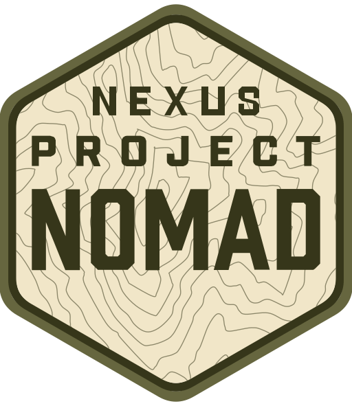

<div align="center">


# Nexus Project NOMAD
### Conhecimento Civilizatório que Nunca Fica Offline

[](https://github.com/ONeithan/Nexus-Nomad)
[-green)](https://github.com/ONeithan/Nexus-Nomad)
[](https://github.com/ONeithan/Nexus-Nomad)
[](https://github.com/ONeithan/Nexus-Nomad)

</div>

---

O **Nexus Project NOMAD** é um servidor dedicado de conhecimento civilizatório, sobrevivência, ciência e educação autossuficiente em **Português Brasileiro (PT-BR)**, projetado para operar **100% offline** na rede local.

Em cenários de indisponibilidade prolongada de internet, concessionárias de energia ou abastecimento urbano, o servidor provê enciclopédias completas, manuais de engenharia rural, tratamento de água, bioconstrução, primeiros socorros, cartografia vetorial e acervo histórico para toda a família.

---

## 🎯 Arquitetura Oficial do Homelab (Acer TravelMate P449)

Este fork foi dimensionado sob medida para operar como servidor headless 24/7 no **Acer TravelMate P449**:

- **Processador & Memória:** Intel Core i5 (7ª Geração) • 16 GB RAM.
- **Disco Primário (M.2 NVMe — 1 TB):** Sistema operacional **Debian Stable (Netinst sem interface gráfica)**, Docker Engine, MySQL 8 e Redis com baixa latência.
- **Disco Secundário (HDD SATA 2,5" — 1 TB em `/mnt/nomad_storage`):** Pool principal detectado automaticamente pelo instalador para armazenar os arquivos ZIM do Kiwix (Wikipédia PT, MDWiki), mapas regionais, livros PDF/EPUB e o acervo histórico recuperado do **Nexus-Odyssey** (incluindo `The Gutemberg Bible 1454.pdf` de 6,58 GB e os 19 volumes da *Biblioteca Mestre*).
- **Proteção contra Queda de Energia (Bateria Danificada):** Sistemas de arquivos `ext4` mantidos com *journaling* completo ativo, montagem secundária com flag `nofail` no `/etc/fstab` (evitando travamento em *emergency mode* no boot) e políticas Docker `restart: unless-stopped`.
- **Inteligência Artificial 100% Remota via LAN (Zero Peso Local):** O Acer TravelMate P449 **não executa LLMs locais**. O módulo de IA conecta-se via rede local (`ai.remoteOllamaUrl`) ao Ollama rodando em outra máquina mais potente do homelab (ex: Dell OptiPlex Micro 7000 `i5-14500T` com 32 GB DDR5 ou PC principal).
- **Integração Opcional com TrueNAS Scale (`NEXUS-STORAGE`):** Suporte a montagem de dataset NFS dedicado e isolado para expansão futura, sem tocar em pools ou serviços existentes.

---

## 🚀 Instalação Automática no Servidor Debian (1 Comando)

Com o Debian instalado no NVMe e o HD de 1 TB montado em `/mnt/nomad_storage`, conecte via SSH e execute:

```bash
curl -fsSL https://raw.githubusercontent.com/ONeithan/Nexus-Nomad/main/install/install_nomad.sh -o install_nomad.sh && sudo bash install_nomad.sh
```

O instalador em português:
1. Instala o Docker Engine e o Docker Compose v2 automaticamente;
2. Detecta `/mnt/nomad_storage` (HD de 1 TB) e aponta todo o armazenamento pesado de aplicativos para ele;
3. Baixa a imagem `ghcr.io/oneithan/nexus-nomad:latest` (ou compila automaticamente direto do código-fonte deste repositório caso o pacote GHCR esteja privado ou em construção);
4. Inicia o Centro de Comando na porta `8080`.

Acesse de qualquer computador ou celular na mesma rede:
```text
http://IP_DO_ACER:8080
```

---

## 📦 Módulos Disponíveis no Centro de Comando

| Módulo | Tecnologia | Função no Servidor |
| :--- | :--- | :--- |
| **Biblioteca Offline** | Kiwix (`:8090`) | Wikipédia em Português, Wikilivros, MDWiki Medicina e pacotes ZIM offline. |
| **Manuais Civilizatórios** | Markdoc Nativo | 28 guias técnicos em PT-BR integrados direto em `/docs/home` (água, horta, solar, forja, saúde). |
| **Gerenciador de Arquivos** | FileBrowser (`:8410`) | Upload e organização via navegador das pastas `zim`, `books`, `maps` e `media` no HD de 1 TB. |
| **Biblioteca de Livros** | Calibre Web (`:8420`) | Leitura e catalogação de PDFs e EPUBs no navegador. |
| **Plataforma Educacional** | Kolibri Gen 2 (`:8310`) | Cursos interativos, matemática, ciências e Khan Academy em português. |
| **Mapas Offline** | ProtoMaps | Mapas vetoriais offline do Brasil e do mundo sem depender de internet. |
| **Assistente de IA (LAN)** | Ollama Remoto + Qdrant | Chat com RAG nos documentos locais usando processamento de outro PC da rede. |
| **Sistema & Discos** | Disk Collector | Painel estilo TrueNAS exibindo em tempo real os discos físicos conectados (`lsblk`), modelo, barramento NVMe/SATA e partições. |

---

## ⚖️ Licença

- **Base:** Project NOMAD (Apache License 2.0).
- **Customização, Acervo Civilizatório & Tradução PT-BR:** [ONeithan/Nexus-Nomad](https://github.com/ONeithan/Nexus-Nomad).
