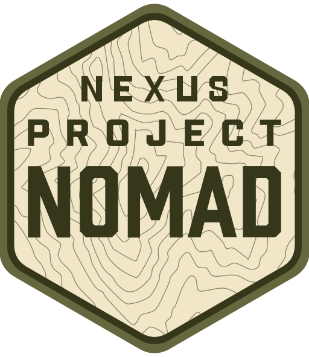
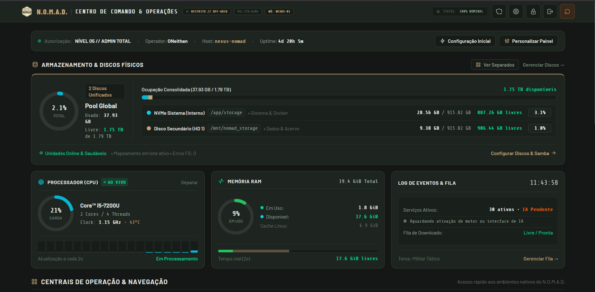
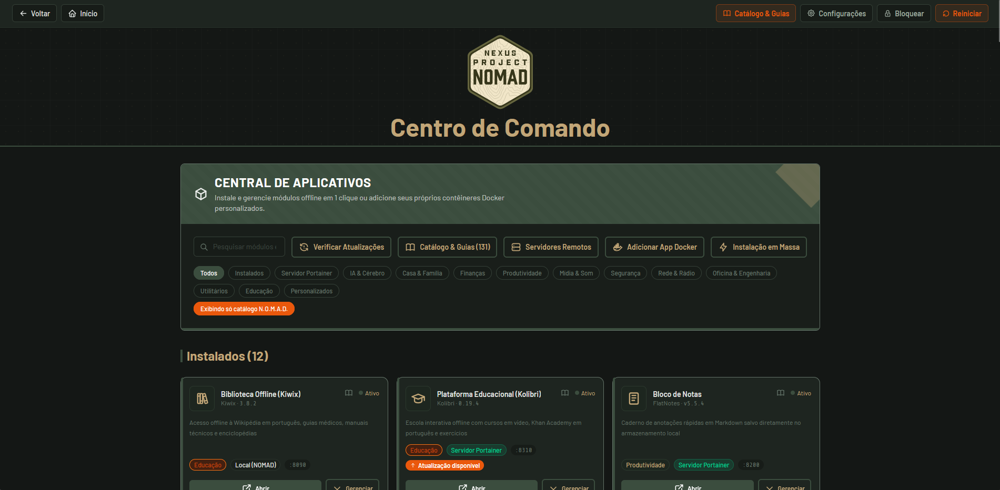
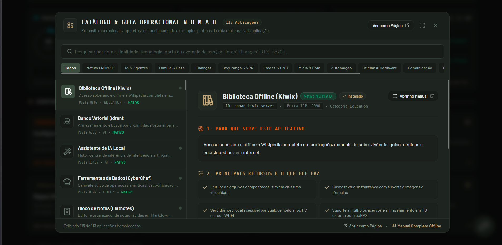
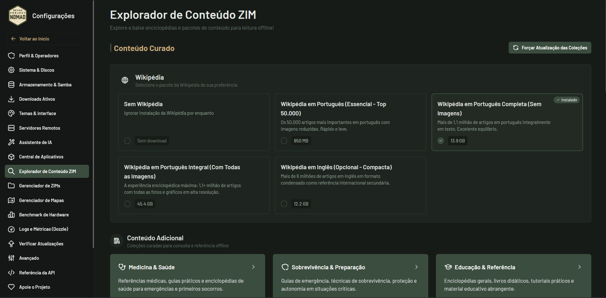
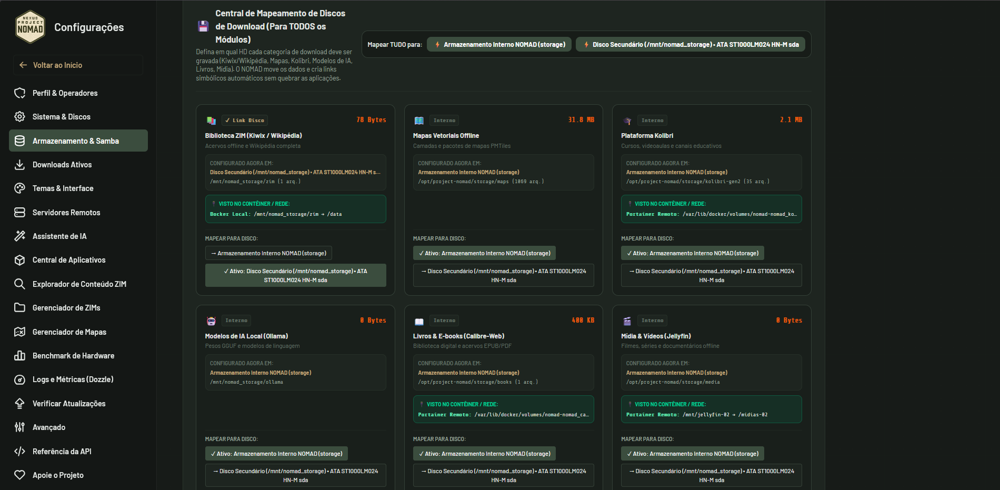
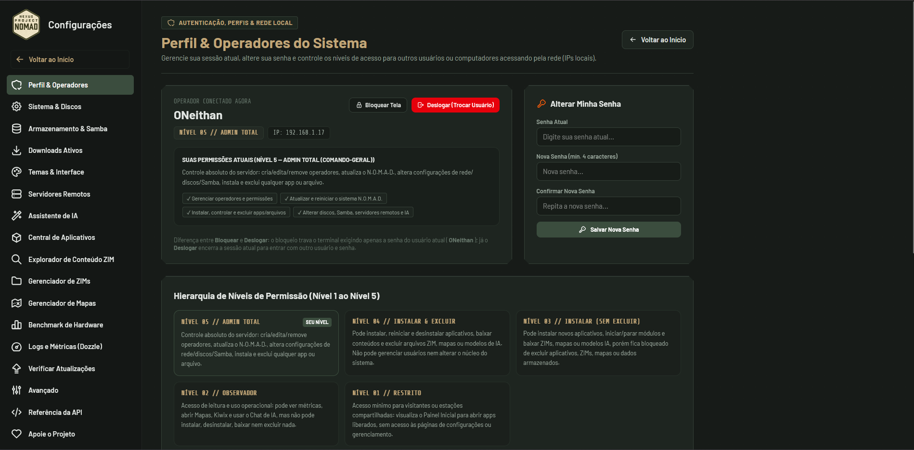

<div align="center">


# Nexus Project N.O.M.A.D.
### Sistema Operacional Tático de Campo, Sobrevivência & Arca do Conhecimento 100% Offline

[-green)](https://github.com/ONeithan/Nexus-Nomad)
[-blue)](https://github.com/ONeithan/Nexus-Nomad)
[](https://github.com/ONeithan/Nexus-Nomad/pkgs/container/nexus-nomad)
[](https://github.com/ONeithan/Nexus-Nomad/wiki)
[](LICENSE)

</div>

---

> [!IMPORTANT]
> ### 📖 Documentação Completa na Wiki Oficial
> **Para guias passo a passo, manuais de 113 aplicações, tutoriais de mapeamento de HDs, configuração de GPU (RTX) para IA e controle de operadores, acesse a [Wiki Oficial do Nexus N.O.M.A.D.](https://github.com/ONeithan/Nexus-Nomad/wiki):**
> * 🛰️ [Centro de Comando & Telemetria ao Vivo](https://github.com/ONeithan/Nexus-Nomad/wiki/Home)
> * 🚀 [Instalação, Boot Militar & Primeiro Acesso](https://github.com/ONeithan/Nexus-Nomad/wiki/Instalacao-e-Primeiros-Passos)
> * 🛡️ [Segurança, Perfis & Níveis de Operador (01 a 05)](https://github.com/ONeithan/Nexus-Nomad/wiki/Seguranca-e-Autenticacao)
> * 📦 [Central de Aplicativos, Catálogo & Guias (113 Apps)](https://github.com/ONeithan/Nexus-Nomad/wiki/Central-de-Aplicativos)
> * 📚 [Conteúdo Offline: ZIM, Wikipédia, Kolibri & Mapas](https://github.com/ONeithan/Nexus-Nomad/wiki/Conteudo-Offline-ZIM-Mapas-e-Educacao)
> * 💾 [Discos, Armazenamento, Mapeamento em Lote & Downloads](https://github.com/ONeithan/Nexus-Nomad/wiki/Discos-Armazenamento-e-Samba)
> * 🤖 [Inteligência Artificial, Open WebUI & Assistente Nativo](https://github.com/ONeithan/Nexus-Nomad/wiki/Inteligencia-Artificial-e-Chat)
> * ⚙️ [Configurações do Sistema, Atualizações & Temas Táticos](https://github.com/ONeithan/Nexus-Nomad/wiki/Configuracoes-do-Sistema-e-Temas)

---

## 🎯 O Que é o Nexus Project N.O.M.A.D.?

O **Nexus Project N.O.M.A.D.** (*Network Operations, Mapping & Autonomous Defense*) é uma suíte operacional completa projetada para transformar qualquer computador portátil, servidor doméstico ou homelab em uma **Arca de Sobrevivência e Conhecimento Civilizatório**.

Construído sob a doutrina **100% Off-Grid**, o sistema opera de forma autônoma sem requisições para a nuvem, mantendo todas as ferramentas de comunicação, saúde, educação, cartografia, engenharia, criptografia e inteligência artificial disponíveis mesmo em cenários de desastre natural, apagão cibernético ou colapso de infraestrutura.

---

## 📸 Conheça o Sistema por Dentro

### 1. Centro de Comando Tático & Telemetria em Tempo Real
Painel unificado com monitoramento de ciclos curtos de CPU (carga, frequência e temperatura), cálculo exato de memória RAM e consolidação de unidades de armazenamento em um **Pool Global**.



### 2. Central de Aplicativos com Mais de 100 Ferramentas Integradas
Instalação e controle de contêineres Docker em apenas 1 clique, com suporte a seleção e instalação em massa, e detecção de destino (`Local` ou `Portainer`).



### 3. Catálogo & Guia Operacional Completo (113 Aplicações em PT-BR)
Cada um dos 113 módulos inclui uma ficha técnica com propósito operacional, arquitetura interna de funcionamento e exemplos práticos da vida real.



### 4. Acervo ZIM Civilizatório, Wikipédia e Educação Offline
Pacotes completos da Wikipédia em português com ou sem imagens, manuais médicos de emergência, guias de sobrevivência e canais educacionais do **Kolibri** (Khan Academy, PhET e StoryWeaver).



### 5. Central de Mapeamento de Discos de Download (Para TODOS os Módulos)
Botão mestre **"⚡ Mapear TUDO para este HD"** que move automaticamente pastas de dados pesados para HDs secundários ou externos sem quebrar nenhuma aplicação.



### 6. Sistema Real de Autenticação em MySQL & 5 Níveis de Permissão
Banco relacional com senhas protegidas por hash `scrypt`, separação entre **Bloquear Terminal** e **Deslogar**, e controle de permissões por nível militar (Nível 01 a 05).



---

## 🚀 Instalação Rápida

### Opção 1: Instalação Automática em 1 Comando (Debian 12/13 ou Ubuntu)

Em um servidor Linux limpo, execute:

```bash
sudo apt-get update && sudo apt-get install -y curl && \
curl -fsSL https://raw.githubusercontent.com/ONeithan/Nexus-Nomad/main/install/install_nomad.sh -o install_nomad.sh && \
sudo bash install_nomad.sh
```

---

### Opção 2: Via Docker Compose

Crie o arquivo `docker-compose.yml` em `/opt/project-nomad`:

```yaml
version: '3.8'

services:
  nomad_admin:
    image: ghcr.io/oneithan/nexus-nomad:latest
    container_name: nomad_admin
    restart: unless-stopped
    ports:
      - "8080:8080"
    volumes:
      - /var/run/docker.sock:/var/run/docker.sock
      - /opt/project-nomad/storage:/app/storage
      - /mnt:/mnt
      - /media:/media
      - nomad-update-shared:/app/update-shared
    environment:
      - NODE_ENV=production
      - PORT=8080
      - HOST=0.0.0.0
      - APP_KEY=nomad_secret_military_key_security_32_chars
      - DB_HOST=mysql
      - DB_PORT=3306
      - DB_USER=nomad_user
      - DB_PASSWORD=nomad_secure_password
      - DB_DATABASE=nomad
      - REDIS_HOST=redis
      - REDIS_PORT=6379
      - NOMAD_STORAGE_PATH=/opt/project-nomad/storage
    depends_on:
      mysql:
        condition: service_healthy
      redis:
        condition: service_healthy

  mysql:
    image: mysql:8.0
    container_name: nomad_mysql
    restart: unless-stopped
    environment:
      - MYSQL_ROOT_PASSWORD=nomad_root_secure
      - MYSQL_DATABASE=nomad
      - MYSQL_USER=nomad_user
      - MYSQL_PASSWORD=nomad_secure_password
    volumes:
      - /opt/project-nomad/mysql:/var/lib/mysql
    healthcheck:
      test: ["CMD", "mysqladmin", "ping", "-h", "localhost"]
      interval: 10s
      timeout: 5s
      retries: 5

  redis:
    image: redis:7-alpine
    container_name: nomad_redis
    restart: unless-stopped
    healthcheck:
      test: ["CMD", "redis-cli", "ping"]
      interval: 10s
      timeout: 5s
      retries: 5

  dozzle:
    image: amir20/dozzle:v10.0
    container_name: nomad_dozzle
    restart: unless-stopped
    ports:
      - "9999:8080"
    volumes:
      - /var/run/docker.sock:/var/run/docker.sock
    environment:
      - DOZZLE_ENABLE_ACTIONS=false
      - DOZZLE_ENABLE_SHELL=false

volumes:
  nomad-update-shared:
```

Suba o sistema:
```bash
docker compose up -d
```

Acesse no navegador:
```text
http://localhost:8080   (ou http://IP-DO-SERVIDOR:8080)
```

---

## 🔑 Portas Padrão & Credenciais de Fábrica

| Aplicação | Porta TCP | Rota / Proxy Nativo | Credenciais Padrão | Finalidade |
| :--- | :---: | :--- | :--- | :--- |
| **Centro de Comando NOMAD** | `:8080` | `/home` | Cadastrado no 1º acesso | Painel principal e orquestrador do sistema |
| **Monitor de Logs Docker (Dozzle)** | `:9999` | Integrado ao NOMAD | Sessão do NOMAD | Monitoramento de logs de contêineres em tempo real |
| **Open WebUI (Chat IA)** | `:8500` | `/chat` (seletor) | Cadastro no 1º acesso | Interface avançada de inteligência artificial |
| **Biblioteca Offline (Kiwix)** | `:8090` | `/` | Aberto / Sem senha | Consulta a arquivos ZIM e Wikipédia |
| **Ferramentas de TI (IT-Tools)** | `:8430` | `/apps-pt/it-tools/` | Aberto (100% PT-BR) | Utilitários de rede, conversão e criptografia |
| **Ferramentas de Dados (CyberChef)**| `:8100` | `/apps-pt/cyberchef/` | Aberto (100% PT-BR) | Canivete suíço de análise e decodificação |
| **Gerenciador de Arquivos (FileBrowser)** | `:8410` | `/` | `admin` / `nomad` | Gerenciador de arquivos web |
| **Biblioteca de E-books (Calibre-Web)** | `:8083` | `/` | `admin` / `admin123` | Leitor e catálogo digital de livros (pasta `/books`) |
| **Manipulação de PDFs (Stirling PDF)**| `:8087` | `/` | Aberto localmente | Divisão, mesclagem e OCR em PDFs |
| **Educação Offline (Kolibri)** | `:8085` | `/` | Cadastrado no 1º acesso | Cursos Khan Academy, Simulações PhET e livros |
| **Rede Samba (Compartilhamento LAN)**| Porta SMB | `\\IP-DO-NOMAD\nomad` | Definido em Armazenamento | Acesso via rede local Windows Explorer e Mac Finder |

---

## 💻 Requisitos de Hardware

| Perfil de Uso | Processador | Memória RAM | Armazenamento |
| :--- | :--- | :--- | :--- |
| **Mínimo** | x86_64 Dual-Core | 4 GB | 32 GB SSD |
| **Recomendado** | x86_64 Quad-Core | 8 a 16 GB | 500 GB a 1 TB+ (SSD/HD) |
| **Com IA Local (Ollama/WebUI)** | x86_64 Moderno | 16 GB+ | 1 TB+ NVMe (+ GPU NVIDIA/AMD opcional) |

> [!TIP]
> **Aceleração com GPU Externa na Rede Local:** Você pode rodar o N.O.M.A.D. em um notebook ou servidor modesto e conectar a IA diretamente à placa de vídeo do seu PC gamer (ex: RTX 5060) através da rede local. Veja o passo a passo completo no guia de [Inteligência Artificial na Wiki](https://github.com/ONeithan/Nexus-Nomad/wiki/Inteligencia-Artificial-e-Chat).

---

## 📜 Licença e Termos de Uso

* **Projeto Aberto e Não Comercial:** O Nexus Project N.O.M.A.D. é distribuído livremente para fins de sobrevivência, estudo, preparação comunitária e uso pessoal.
* **Proibição Comercial:** É expressamente **proibida** a comercialização, venda, revenda ou licenciamento pago de distribuições derivadas desta versão. Consulte o arquivo [LICENSE](LICENSE) para maiores detalhes.
* **Créditos:** Baseado e expandido a partir da fundação open-source do [Project NOMAD](https://github.com/Crosstalk-Solutions/project-nomad) (Apache 2.0).
